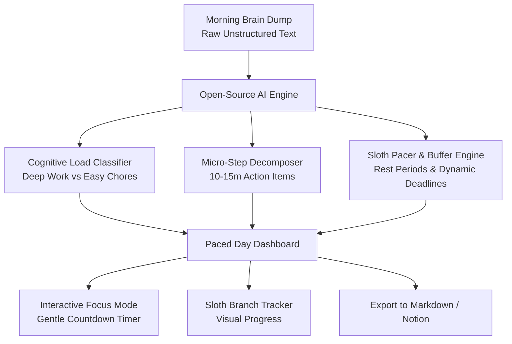

# 🦥 SlothPace — The "Slow & Steady" Daily Task Decomposer & Gentle Deadline Pacer

[](https://dev.to/challenges/hacktoberfest-week3-2026-10-19)
[](./LICENSE)
[](./)
[](./)

> *"The tree that climbs slowly reaches the sun just the same."*  
> **SlothPace** transforms your chaotic morning brain-dumps into structured, micro-timed steps with **100% offline, privacy-first open-source AI**.

---

## 📖 The Story & Hacktoberfest 2026 Theme: "Slow and Steady"

In an industry obsessed with frantic hustle culture and burnout, **Week 3 of Hacktoberfest 2026 celebrates International Sloth Day** with the theme **"Slow and Steady"**.

The goal: *build software with open-source AI at its core that automates tedious, exhausting mental chores so humans don't have to scramble.*

### ⚡ The Problem: Executive Function Fatigue & Deadline Paralysis
Every morning, developers and creators face a wall of vague, intimidating tasks:
- *"Fix the broken auth token refresh bug"*
- *"Reply to 15 pending emails and PR reviews"*
- *"Prepare architecture slides for tomorrow's standup"*
- *"Investigate memory leak in docker worker"*

Staring at a chaotic to-do list triggers **decision paralysis**. For people who struggle to focus without clear deadlines or urgency, breaking tasks down manually is an exhausting chore in itself—so we procrastinate for hours just avoiding the planning!

### 🌿 The Solution: SlothPace
SlothPace takes your raw, unstructured morning brain dump and handles the heavy cognitive lifting:
1. **Decomposes monolithic tasks** into bite-sized **5–15 minute micro-steps**.
2. **Classifies cognitive load**: Identifies **⚡ Deep Focus** (high cognitive energy) vs. **🌿 Easy Chores** (low cognitive friction).
3. **Allots Gentle Deadlines**: Dynamically calculates start and end timestamps so you have clear pacing without panic.
4. **Mandatory Sloth Pauses**: Automatically interleaves restorative eye-rest and hydration breaks after sustained deep work.
5. **Interactive Focus Timer**: A gentle deadline companion with panic-free buffer extensions and procedural rain/white noise.

---

## 🔒 Why Open Innovation & Open-Source AI Matters

Closed-source cloud AI APIs create major friction for personal productivity:
* **Zero Data Leakage:** Your morning brain dump contains intimate thoughts, confidential company bugs, client roadmap tickets, and personal chores. SlothPace runs **100% locally on your machine via Transformers.js / local NLP**. Not a single byte leaves your laptop.
* **100% Offline Resilience:** Works on flights, trains, in cabins, or during internet blackouts.
* **Zero API Keys & Zero Costs:** Free forever for anyone in the world without subscriptions or rate limits.

---

## ✨ Key Features & Screenshots

| Feature | Description |
| :--- | :--- |
| **🧠 Chaotic Brain Dump** | Paste any raw, unstructured thoughts or bullet points at the start of your day. |
| **⚡ Deep vs. 🌿 Easy Work** | Open-source NLP categorizes tasks based on mental effort and cognitive strain. |
| **⏱️ Gentle Deadlines** | Timed scheduling gives ADHD and deadline-motivated minds structured pacing without anxiety. |
| **🦥 Sloth Branch Progress** | A visual sloth companion that steadily crawls across a tree branch as you check off micro-steps. |
| **🛡️ Panic-Free Buffer (+10m)** | Running late? One click adds a buffer and shifts downstream tasks gracefully. |
| **🌧️ Procedural Focus Ambience** | Built-in Web Audio API sound generator for forest rain and zen brown noise (zero external audio files). |
| **📝 Export Anywhere** | One-click export to clean Markdown for Obsidian, Notion, Logseq, or Slack standups. |

### 📸 Visual Previews
See the full visual walkthrough and screenshots guide in [`docs/SCREENSHOTS_AND_DEMO_GUIDE.md`](./docs/SCREENSHOTS_AND_DEMO_GUIDE.md).

* **Morning Brain Dump:** `docs/screenshots/01-morning-brain-dump.png`
* **Paced Schedule:** `docs/screenshots/02-paced-schedule-dashboard.png`
* **Focus Timer:** `docs/screenshots/03-gentle-focus-timer.png`

---

## 🛠️ Architecture & Tech Stack



* **Frontend:** React 19, TypeScript, Vite
* **Styling:** Tailwind CSS v4, Lucide React Icons
* **Open-Source AI Core:** `@huggingface/transformers` + Local Client-Side NLP Decomposition
* **Audio Engine:** Native Web Audio API (procedural synthesis, 100% offline)
* **Effects:** Canvas Confetti

---

## 🚀 Quick Start (Run Locally in 60 Seconds)

### Prerequisites
* [Node.js](https://nodejs.org/) (v18 or higher)
* `npm` or `pnpm`

### Installation
```bash
# 1. Clone the repository
git clone https://github.com/SAPNIL-M/slothpace.git
cd slothpace

# 2. Install dependencies
npm install

# 3. Start the local development server
npm run dev
```

Open your browser at `http://localhost:5173` and start pacing your day!

### Build for Production
```bash
npm run build
```
The optimized static build will be in the `/dist` directory, ready to deploy to GitHub Pages, Vercel, or Netlify.

---

## 📄 License
This project is open-source under the [MIT License](./LICENSE).

Built with 💚 and steady patience for **Hacktoberfest 2026**.
